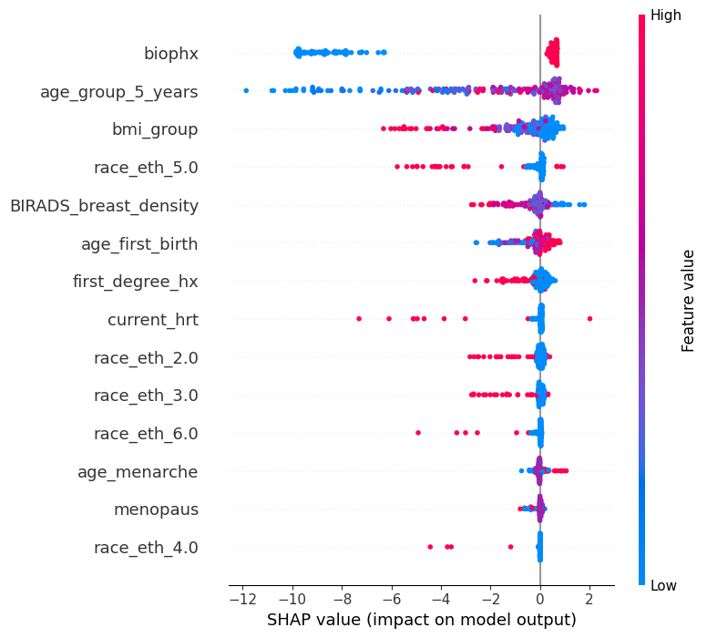
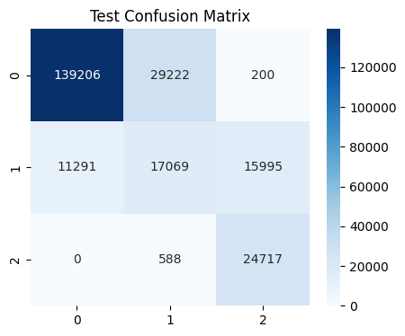

# Breast Cancer Risk Prediction with a Borderline Class

**Code for *"Evaluating the Accuracy–Explainability Trade-off Across Binary and Multi-Class Models for Breast Cancer Detection"*, accepted at IEEE CODASSCA 2026.**

Screening models are usually built to answer one question: *does this patient have cancer?*
We added a second one: *which patients don't have cancer, but look like those who do?*
Using 1.19 million mammography records from the Breast Cancer Surveillance Consortium,
we trained a linear SVM, XGBoost and a neural network for both questions, tuned them for
**recall** (a missed cancer costs far more than a false alarm), and explained every model with
SHAP or LIME so a clinician can see *why* it flagged someone.


*SHAP values of the XGBoost model for the borderline class: biopsy history, age and BMI push patients into the high-risk group.*

## The borderline class

A logistic regression is fit on the binary label. Patients **without** cancer whose predicted
probability lies in **[0.35, 0.50]** become class 2:

| class | who | records |
|---|---|---:|
| 0 · no cancer | everyone else | 888,887 |
| 1 · cancer | `breast_cancer_history = 1` | 221,776 |
| 2 · borderline | no cancer, but p(cancer) between 0.35 and 0.50 | 80,775 |

The upper bound keeps anyone the baseline would already call "cancer" out of the group.
0.30 made the band too wide (many clearly healthy patients) and 0.40 left too few to learn
from, so 0.35 was used. Code: [`src/bcxai/borderline.py`](src/bcxai/borderline.py).

## Results

**Binary** (test set, 238,288 patients)

| model | decision rule | accuracy | precision | **recall** | F1 |
|---|---|---:|---:|---:|---:|
| Linear SVM | decision threshold −0.05 | 0.69 | 0.35 | 0.78 | 0.48 |
| XGBoost | Optuna-tuned, `scale_pos_weight` | 0.70 | 0.36 | 0.81 | **0.50** |
| Neural network | threshold 0.40 (chosen by F2 on validation) | 0.64 | 0.32 | **0.87** | 0.47 |

**Three classes**: per-class recall (no cancer / cancer / borderline)

| model | setting | accuracy | recall 0 | recall 1 | recall 2 |
|---|---|---:|---:|---:|---:|
| Linear SVM | imbalanced | 0.73 | 0.86 | 0.19 | 0.75 |
| Linear SVM | majority class downsampled | 0.62 | 0.80 | 0.45 | 0.40 |
| XGBoost | imbalanced | 0.81 | 0.95 | 0.28 | 0.69 |
| XGBoost | majority class downsampled | 0.69 | 0.75 | **0.61** | 0.76 |
| Neural network | class weights | 0.76 | 0.83 | 0.38 | **0.98** |

What we took from it:

* **XGBoost is the most balanced model**: the best binary F1, and after downsampling the best three-class trade-off.
* **The neural network is the most aggressive about recall**: 87% of cancer cases caught in the binary task, and almost every borderline patient (98%) identified. Many cancer cases it misses land in the borderline class rather than "healthy", which is the safer mistake.
* **A linear model struggles with the three-class problem.** The SVM's cancer recall drops to 0.19 on imbalanced data.
* **The explanations agree across models.** Biopsy history, age and BMI drive the tree and neural models; hormone replacement therapy is the strongest signal for the SVM.



**Robustness.** Retraining the network with different seeds (fresh stratified splits, class
weights recomputed on training data only) gives binary recall **0.882 ± 0.009** over five seeds
and multiclass macro recall **0.755 ± 0.001** over three
([notebook 05](notebooks/05_ann_robustness_multiple_seeds.ipynb)).

## Data

The [BCSC](https://www.bcsc-research.org/) risk-factor dataset: mammograms from 2005 to 2017 with
age, race/ethnicity, family history, age at menarche, age at first birth, breast density,
hormone therapy, menopausal status, BMI, biopsy history and breast cancer history. About 1.5M
rows before cleaning and 1,191,438 after (14 features once race is one-hot encoded); 18.6% have
a cancer history. The data isn't redistributed here. See [`data/README.md`](data/README.md).

Cleaning ([`src/bcxai/data.py`](src/bcxai/data.py)): drop `year` and `count`, treat code 9 as
missing (except in the age-group column, where 9 is a real band), drop rows with unknown
target, fill gaps with each column's mode, one-hot encode race/ethnicity.

## Repository layout

```
├── notebooks/
│   ├── 01_eda_and_borderline_class.ipynb
│   ├── 02_svm_lime.ipynb                     # binary + 3-class SVM, LIME
│   ├── 03_xgboost_shap.ipynb                 # Optuna-tuned XGBoost, SHAP
│   ├── 04_ann_shap.ipynb                     # Optuna-tuned neural network, SHAP
│   └── 05_ann_robustness_multiple_seeds.ipynb
├── src/bcxai/
│   ├── data.py          # loading + cleaning shared by all notebooks
│   ├── borderline.py    # the three-class labelling
│   └── evaluation.py    # threshold tuning (F2), threshold sweeps, downsampling
├── tests/               # unit tests on synthetic data
├── results/figures/
└── data/README.md       # how to get the BCSC files
```

The notebooks keep the outputs of the runs reported in the paper (trained in Google Colab).

## Running it

```bash
git clone https://github.com/sarkiskalikian/breast-cancer-xai-borderline.git
cd breast-cancer-xai-borderline
pip install -r requirements.txt
pytest
```

Then download the three BCSC files into `data/` and run the notebooks in order. The neural
network and SHAP KernelExplainer steps are slow on CPU; a GPU runtime helps.

## Limitations

* The borderline class comes from a model's probability, not from a clinical diagnosis. It marks *similarity* to cancer cases on these risk factors, nothing more.
* Strong class imbalance still limits performance on the minority classes, especially cancer in the three-class setting.
* The features are coarse categorical risk factors; there is no imaging data.
* Training on the full 1.2M-row dataset limited how much hyperparameter search was practical.

## Background and acknowledgements

This work builds on "Explainable AI for breast cancer risk prediction: evaluating the
accuracy-explainability trade-off", *Machine Learning for Computational Science and
Engineering* (2025), extending it to the full dataset and a third, borderline class.

Data collection and sharing were supported by the Breast Cancer Surveillance Consortium.
